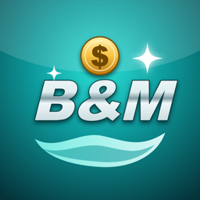
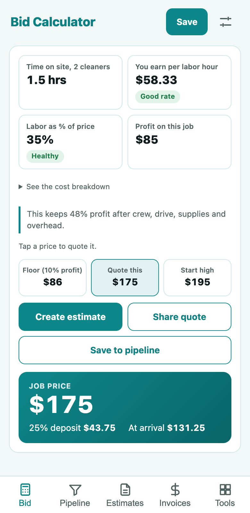
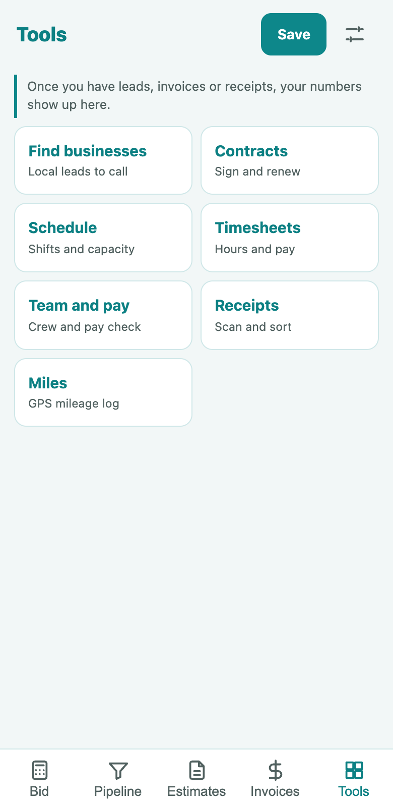

<p align="center"></p>
<h1 align="center">B&M Bids</h1>
<p align="center">A free all-in-one app for cleaning businesses. Find leads, price the job, send the proposal, sign the contract, schedule the crew and get paid.</p>
<p align="center">Made by <a href="https://www.beautyandmusclepm.com/?utm_source=github&utm_medium=readme">Beauty &amp; Muscle</a>, a veteran-owned and woman-owned cleaning company in coastal North Carolina.</p>
<p align="center"> </p>

## Download

**Android:** on your phone, open the [latest release](https://github.com/bin4ryh4Kr/bm-bids-app/releases/latest), download the `.apk` and open it. Your phone will ask you to allow the install.

**iPhone:** coming soon.

## What it does

- **Bid calculator:** residential prices by home size, commercial prices from square feet, fixtures and labor cost. Shows hours, earnings per labor hour, profit and the lowest price worth taking.
- **Job costing:** room-by-room commercial bids with floor types, foot traffic, trash, glass, stairs and elevators, crew size, sales tax, scheduled extras, your own overrides, a side-by-side schedule comparison and an internal job cost PDF.
- **Pipeline:** track leads from first call to won, with follow-up dates, one-tap call, text and email, win rate and average margin. Estimates move leads along by themselves.
- **Find businesses:** search a town for offices, dentists, gyms and more from OpenStreetMap, then add them to your pipeline or share a spreadsheet.
- **Proposals and contracts:** turn an estimate into a branded proposal or a service agreement, signed on the phone.
- **Renewal check:** compare what a contract was priced at with what it really takes, then get a new rate and a plain explanation for the client.
- **Schedule and capacity:** build your regular week, catch double bookings and see how many hours you can still sell.
- **Timesheets:** clock in and out, fill the week from the schedule, count overtime and share a PDF.
- **Team and pay:** keep your crew's pay and hours, and see what matching the going rate would cost.
- **Estimates:** one tap from a bid, with job numbers like `2026-SMITH-01`, deposits and a PDF with your logo.
- **Invoices:** one tap from an estimate, with the deposit taken off, paid and past-due tracking, and next-visit invoices for recurring work.
- **Receipts:** snap a receipt and the phone reads the store, date and total, with no internet needed. Share a report or a spreadsheet at tax time.
- **Miles:** track a business drive by GPS or add it by hand, then share a mileage log.
- **Lock screen:** a PIN, with fingerprint or face unlock where your phone has it.
- **Your look:** light, dark or automatic, with color choices that carry onto your PDFs.
- **Your business, your prices:** set your name, logo, payment details, prices, costs and terms in Settings. New installs start with typical U.S. industry numbers, clearly marked, so you can price a job right away. Replace them with your own in Settings.

No account, no ads, no tracking. Everything stays on your phone, so use Save backup in Settings. The only thing that goes online by itself is Find businesses, which sends the town and type you search to OpenStreetMap. The small line at the bottom of each PDF says the app came from us.

Nothing in this app is legal, tax or pricing advice. Check your terms and prices for your own business and state.

## Build it

Needs Node. Android also needs JDK 17 and the Android SDK. iPhone needs a Mac with Xcode.

```sh
npm install
npm test          # pricing and paperwork checks
npm run dev       # run it in a browser
npm run android   # release build; signing needs your own key
npm run build && npx cap sync ios && npx cap open ios
```

The icon is drawn by `design/icon.mjs`; regenerate the app icons with `npx @capacitor/assets generate`.

Built with React, Vite, Capacitor and jsPDF.
